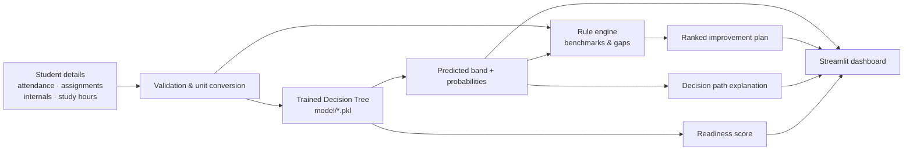

# Project Report
## Intelligent Student Performance Prediction System

**Domain:** Artificial Intelligence / Machine Learning
**Technique:** Supervised learning — multi-class classification with a Decision Tree
**Tools:** Python, scikit-learn, pandas, NumPy, Streamlit, Plotly, Matplotlib

---

## 1. Abstract

Students rarely discover that they are falling behind until the results are
published, when it is too late to act. This project builds a system that reads
four easily available academic indicators — attendance, assignment marks,
internal marks and daily study hours — and predicts whether the student's
performance is **Excellent, Good, Average or Poor**. The prediction is produced
by a Decision Tree classifier trained on 1,500 student records and achieves
**86.3% accuracy on unseen data**. Beyond the label, the system extracts the
exact decision path that produced the result and turns the weakest indicators
into a prioritised, actionable improvement plan. The result is an early-warning
tool that is accurate, explainable and immediately useful to both students and
mentors.

---

## 2. Introduction

Internal assessment data is collected by every college, but it is usually only
used for record-keeping. The same data contains enough signal to identify
at-risk students weeks before an exam. Machine learning is well suited to this
because the relationship between attendance, assignments, internals and study
habits is not a simple threshold — students compensate in different ways, and
the boundaries between performance bands overlap.

A Decision Tree was chosen deliberately. Neural networks and ensembles are more
accurate on many tasks, but a tree can be printed as a set of if/else rules.
For an academic advisory system, **being able to justify a prediction matters
more than the last two points of accuracy**, because the advice must be trusted
by a student and defensible to a teacher.

---

## 3. Objectives

1. Accept student academic details as input.
2. Consider attendance, assignment marks, internal marks and study hours.
3. Classify performance into Excellent / Good / Average / Poor.
4. Explain the prediction using the learned decision rules.
5. Suggest concrete areas of improvement, ranked by priority.
6. Present everything through an accessible interface.

---

## 4. Literature and concepts used

| Concept | Role in the project |
|---|---|
| Supervised learning | Learning a mapping from labelled examples |
| Classification | Predicting one of four discrete bands |
| Decision Tree | The deployed model; axis-aligned if/else splits |
| Gini impurity | Split criterion: `1 − Σ pᵢ²` |
| Train/test split | Unbiased estimate of generalisation |
| Stratified sampling | Preserves class proportions in both sets |
| Cross-validation | 5-fold estimate of model stability |
| Precision / Recall / F1 | Per-class quality, important for imbalanced bands |
| Confusion matrix | Shows *which* bands get confused |
| Feature importance | Mean impurity decrease contributed by each feature |
| Overfitting control | `max_depth` and `min_samples_leaf` limits |

---

## 5. Methodology

### 5.1 Data collection

Real student records are confidential, so a synthetic cohort of 1,500 students
was generated with a documented process (`generate_dataset.py`):

1. Each student receives two hidden traits, *diligence* and *ability*, drawn
   from a normal distribution.
2. The four indicators are generated from those traits plus random noise, which
   makes them realistically correlated.
3. A weighted composite score is computed and Gaussian noise (σ = 2.5) is
   added, so two students with identical inputs can still land in different
   bands.
4. The score is mapped to a band using fixed thresholds.
5. Students below 75% attendance are capped at **Average**, reflecting the
   standard detention rule. Without this rule the model learned to call a
   student with 40% attendance and perfect marks "Excellent", which is not
   acceptable in practice.

This avoids a trivially separable dataset and gives the classifier a genuine
problem to solve.

### 5.2 Feature selection

| # | Feature | Type | Range | Justification |
|---|---|---|---|---|
| 1 | `attendance_pct` | Numeric | 0–100 | Direct measure of engagement; eligibility rule in most colleges |
| 2 | `assignment_pct` | Numeric | 0–100 | Continuous assessment; the most controllable component |
| 3 | `internal_pct` | Numeric | 0–100 | Strongest predictor of the final examination |
| 4 | `study_hours` | Numeric | 0–10 | Measures effort outside class |

`composite_score` is excluded because it is derived from these four features and
determines the label — using it would be **data leakage**.

### 5.3 Target definition

```
score = 0.20·attendance + 0.25·assignment + 0.35·internal
      + 0.20·min(study_hours/6, 1)·100 + noise(σ = 2.5)

Excellent ≥ 85 · Good ≥ 70 · Average ≥ 50 · Poor < 50
if attendance < 75 → band is capped at Average (detention rule)
```

Resulting distribution: Excellent 14.6%, Good 24.9%, Average 48.6%, Poor 11.9%.

### 5.4 Training procedure

* 80/20 stratified train–test split (1,200 / 300 records, `random_state=42`).
* `DecisionTreeClassifier(criterion="gini", max_depth=6,
  min_samples_leaf=8, min_samples_split=10)`.
* Hyper-parameters selected by comparing depth 5–8 and leaf sizes 3–15 on
  accuracy, macro F1 and tree readability.
* Evaluation: hold-out accuracy, macro F1, per-class report, confusion matrix,
  and 5-fold stratified cross-validation.
* Three alternative classifiers trained on the identical split for comparison.

---

## 6. System design



### 6.1 Module description

| Module | Responsibility |
|---|---|
| `generate_dataset.py` | Simulates the student population, computes labels, writes CSV |
| `train_model.py` | Splits, trains, evaluates, compares, exports model + metrics + tree |
| `predictor.py` | Loads the model; prediction, decision path, ratings and advice rules |
| `app.py` | Streamlit interface: predict, insights, dataset tabs |
| `predict.py` | Console interface for demos without a browser |
| `model/metrics.json` | Single source of truth for every number shown in the UI |

### 6.2 Prediction flow

1. The user enters the four indicators (percentages) and optional identity.
2. Inputs are assembled into a one-row DataFrame in the training column order.
3. `DecisionTreeClassifier.predict()` returns the band;
   `predict_proba()` returns a distribution over all four bands.
4. The decision path is re-walked manually to list the conditions that fired.
5. The rule engine rates each indicator, ranks the gaps and appends
   band-specific advice.
6. Everything is rendered as a result card, gauge, probability chart, profile
   radar and suggestion cards.

---

## 7. Results

### 7.1 Headline metrics

| Metric | Value |
|---|---|
| Hold-out accuracy | **86.3%** |
| Macro-averaged F1 | **0.845** |
| 5-fold cross-validation accuracy | **83.8% ± 1.9%** |
| Tree depth | 6 |
| Leaves | 34 |
| Training / test records | 1,200 / 300 |

The small gap between test accuracy (86.3%) and cross-validation (83.8%)
indicates the model is not overfitting.

### 7.2 Per-class performance

| Band | Precision | Recall | F1 | Support |
|---|---|---|---|---|
| Excellent | 0.826 | 0.864 | 0.844 | 44 |
| Good | 0.819 | 0.797 | 0.808 | 74 |
| Average | 0.910 | 0.904 | 0.907 | 146 |
| Poor | 0.811 | 0.833 | 0.822 | 36 |

Recall for the **Poor** class — the class that matters most for an early-warning
system — is 83.3%, so most struggling students are caught.

### 7.3 Confusion matrix

| Actual ↓ / Predicted → | Excellent | Good | Average | Poor |
|---|---|---|---|---|
| **Excellent** | **38** | 6 | 0 | 0 |
| **Good** | 8 | **59** | 7 | 0 |
| **Average** | 0 | 7 | **132** | 7 |
| **Poor** | 0 | 0 | 6 | **30** |

All errors are between neighbouring bands. No student was predicted two bands
away from the truth, which is consistent with labels derived from a continuous
score.

### 7.4 Model comparison

| Model | Accuracy | Macro F1 |
|---|---|---|
| **Decision Tree (deployed)** | 86.3% | 0.845 |
| Logistic Regression | 84.3% | 0.847 |
| K-Nearest Neighbours (k = 7) | 88.0% | 0.870 |
| Random Forest (100 trees) | 89.0% | 0.874 |

The tree gives up ~3 accuracy points to the Random Forest but every prediction
can be explained as a readable rule path. For an advisory tool whose output must
be justified to a student, that is the right trade.

### 7.5 Feature importance

| Feature | Importance |
|---|---|
| Assignment marks | 0.354 |
| Internal marks | 0.259 |
| Attendance | 0.213 |
| Study hours | 0.173 |

All four indicators contribute. Attendance earns its place twice: it carries
20% of the score and it triggers the detention cap below 75%.

### 7.6 Sample run

Input: attendance 62%, assignments 45%, internals 38%, study 1 h/day.

```
Prediction : ⚠️ POOR      Confidence: 100.0%      Readiness: 40.3/100
Focus first: Internals, Assignments
Plan:      [HIGH] Internal marks → revise within 24 h, solve past papers
           [HIGH] Assignments    → submit on time, use the rubric
           [HIGH] Study hours    → two 50-minute blocks daily
           [HIGH] Get support    → meet the faculty mentor this week
```

---

## 8. Discussion

* **Why the tree works.** The composite score is a weighted sum of the four
  inputs, so the class boundaries are smooth surfaces. A depth-6 tree
  approximates them with axis-aligned splits and reaches 86.3% accuracy; deeper
  trees add little because label noise, not bias, becomes the limiting factor.
* **Where it fails.** Mistakes concentrate between Good and Average, where the
  70-point boundary is crossed by plausible combinations. This is expected and
  is handled in the UI: a borderline confidence message tells the user to treat
  the *advice* as the priority rather than the label.
* **Why the attendance rule matters.** The first version of the dataset let a
  student with 40% attendance and perfect marks be classified "Excellent",
  because attendance was only 20% of the weighted score and strongly correlated
  with the other inputs. Introducing the 75% detention cap both fixed that
  behaviour and raised attendance's importance from 6% to 21%, so the model now
  respects the rule a college would actually apply.
* **Why the advice engine is separate.** A classifier can only say "Poor". It
  cannot say *which* input caused it in a way a student can act on. Keeping the
  rule engine separate makes the recommendations auditable, testable and easy to
  change without retraining.

---

## 9. Conclusion

The system meets all five stated objectives: it accepts student details,
considers the four required indicators, classifies performance into four bands
with 86.3% accuracy, explains each prediction through the decision path, and
produces a ranked improvement plan. The project demonstrates the complete
machine-learning workflow — synthetic data design, feature selection, model
training, honest evaluation against alternatives, and deployment as an
interactive application — while keeping every prediction explainable.

---

## 10. Future scope

1. Train on anonymised institutional data with verified final grades.
2. Add previous-semester GPA, backlog count and subject-wise attendance.
3. Compare with XGBoost and use SHAP values for richer explanations.
4. Predict the numeric final percentage with a regression model.
5. Teacher login, cohort dashboards and automated PDF reports.
6. Monitor drift and retrain every semester.

---

## 11. References

1. Pedregosa et al., *scikit-learn: Machine Learning in Python*, JMLR 12 (2011).
2. L. Breiman, J. Friedman, R. Olshen, C. Stone, *Classification and Regression
   Trees*, Wadsworth, 1984.
3. T. Hastie, R. Tibshirani, J. Friedman, *The Elements of Statistical
   Learning*, 2nd ed., Springer, 2009.
4. Streamlit documentation — <https://docs.streamlit.io>
5. pandas documentation — <https://pandas.pydata.org/docs>
